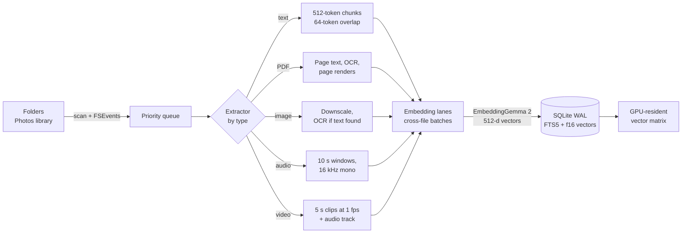
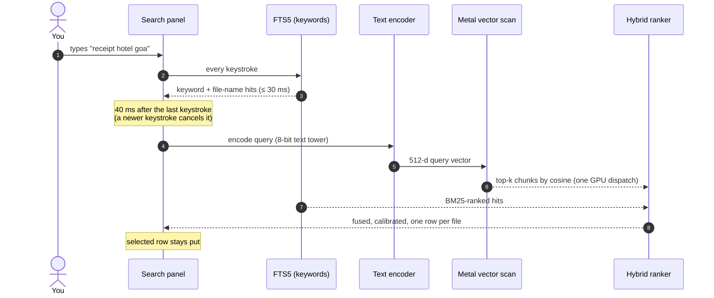
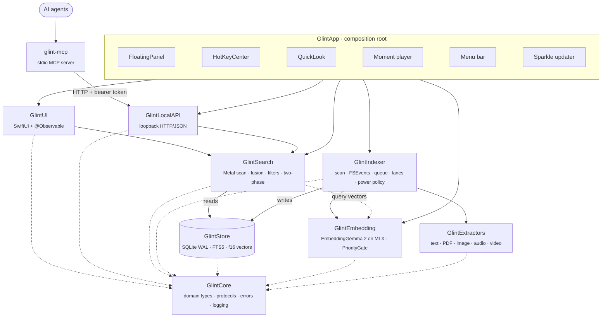

<div align="center">

# Glint

**On-device multimodal search for the Mac.**

Press <kbd>⌥</kbd> <kbd>Space</kbd>, describe what you're looking for, and Glint finds it: photos and screenshots, moments inside videos, things said in recordings, PDF pages and documents. Nothing leaves your Mac.

[](LICENSE)
[](#requirements)
[](#requirements)
[](Package.swift)
[](#the-model-embeddinggemma-2)
[](docs/local-api.md)

[How it works](#how-it-works) ·
[Quick start](#quick-start) ·
[Architecture](#architecture) ·
[Technical decisions](#technical-decisions) ·
[Benchmarks](#benchmarks) ·
[For AI agents](#for-ai-agents) ·
[FAQ](#faq)

</div>

---

## Table of contents

- [Overview](#overview)
- [Features](#features)
- [How it works](#how-it-works)
- [Requirements](#requirements)
- [Quick start](#quick-start)
- [Architecture](#architecture)
- [The model: EmbeddingGemma 2](#the-model-embeddinggemma-2)
- [Technical decisions](#technical-decisions)
- [Benchmarks](#benchmarks)
- [For AI agents](#for-ai-agents)
- [Privacy](#privacy)
- [Development](#development)
- [Repository layout](#repository-layout)
- [Project status](#project-status)
- [FAQ](#faq)
- [Contributing](#contributing)
- [License](#license)

## Overview

Glint is a native macOS app that indexes your files into a single on-device vector space and lets you search them by meaning, not just by name. A query such as *"boarding pass for the Goa flight"* finds the screenshot; *"whiteboard with the Q3 roadmap"* finds the photo; *"dog barking"* finds the second in the video where it happens.

It is a single Swift process with no server and no cloud dependency. A background indexer and an interactive search path share one SQLite index. Embeddings come from [EmbeddingGemma 2](#the-model-embeddinggemma-2), ported to [MLX-Swift](https://github.com/ml-explore/mlx-swift) and running on the Apple silicon GPU.

| | |
| --- | --- |
| **What it searches** | Images (incl. HEIC and screenshots), video, audio, PDFs, text documents, the Apple Photos library |
| **How it searches** | Hybrid: SQLite FTS5 keyword search fused with GPU vector search |
| **Where it runs** | Entirely on your Mac. Network access is limited to the one-time model download and app updates |
| **How fast** | Merged results in 26 ms p95 over 100k chunks (M5, release) |
| **Who can use it** | People, through a Spotlight-style panel; scripts and AI agents, through a loopback API and an MCP server |

## Features

- **One search for every kind of file.** Text, images, video, audio and PDFs are embedded into the same space, so one query ranks across all of them.
- **Lands on the exact moment.** PDFs open at the matched page with terms highlighted; audio and video play from the matched timestamp.
- **Instant as you type.** Keyword results arrive on every keystroke; semantic results follow 40 ms after you stop typing, without reshuffling the row you've selected.
- **Find similar.** Drop any file on the panel to find items like it, whether or not it's indexed.
- **People.** Faces in photos and videos are grouped by person, like Google Photos. Click a face to see every photo and video that person is in; name people, and give two groups the same name to combine them.
- **Stays out of the way.** Indexing yields to search, pauses on Low Power Mode, low battery and serious thermal pressure, and halves its width on battery.
- **Keeps itself current.** FSEvents watches your folders; moves and renames are detected by content hash instead of re-indexing. Network shares (SMB, NFS, AFP) are also rescanned every 15 minutes and on reconnect, and what was indexed stays searchable while a share is disconnected.
- **Built for agents.** An opt-in, token-authenticated local API and a bundled `glint-mcp` server let Claude and other agents search your files.
- **A real Mac app.** AppKit and SwiftUI, VoiceOver labels, String Catalog localization, light and dark mode, Liquid Glass on macOS 26, Sparkle updates.

## How it works

Glint has two paths that run side by side: **indexing** turns files into vectors and text, and **search** turns a query into a ranked list. They meet only at the store and at a priority gate that always favours search.

### 1. Indexing: from file to vectors



1. **Discover.** The scanner walks each source folder; an FSEvents watcher picks up changes afterwards. Files are content-hashed, so duplicates are embedded once and renames are just metadata updates.
2. **Queue.** Documents and images go first, then audio, then video, so the most searchable items are ready soonest.
3. **Extract.** One extractor per media type streams *chunks*: a passage of text, a PDF page, an image, a 10-second audio window, a 5-second video clip. Text found by OCR or an optional on-device transcript goes into the keyword index.
4. **Embed.** Chunks from many files are packed into shared model calls (*embedding lanes*). A long video streams through in windows and never holds every frame in memory.
5. **Commit.** Each file is written in one transaction, so it is either fully indexed or still pending. Files that finish during a commit join the next one (*group commit*).

### 2. Search: from keystroke to result



1. **Keyword phase.** FTS5 matches chunk text and file names on every keystroke. File names are searchable seconds after the first scan, before any embedding has run.
2. **Semantic phase.** The query is embedded by the small, always-warm text tower and compared against every stored vector in a single Metal dispatch.
3. **Calibration.** Raw cosine scores mean different things in different libraries. Glint drops semantic hits that don't stand out from the query's score distribution over *your* library (z-score and robust z-score cut-offs), while keeping hits with a high absolute similarity. This is what lets a search for something you don't have return nothing instead of ten random photos.
4. **Fusion.** Keyword and semantic lists are fused by normalized score, collapsed to the best chunk per file, and given a small recency boost. Partial keyword matches survive only when the file's meaning is also related to the query.

### 3. Why it stays instant

| Technique | Effect |
| --- | --- |
| Vectors in one `Float16` matrix in a shared-storage `MTLBuffer` | CPU writes rows, GPU reads them, no copies; a 100k × 512 scan takes 2.3 ms |
| Only the text tower stays resident, quantized to 8 bit | Query embedding in ~7 ms; vision and audio towers load for indexing and unload when idle |
| Separate read-only WAL connection for search | The search path never waits on the indexer's writes |
| BM25 ranks at most the newest 5,000 FTS matches | A two-letter prefix on a large library stays under budget |
| `PriorityGate` | Indexing waits for search and shrinks its batches while you type |

### 4. People: faces grouped by person

Photos and videos also go through face recognition while they are indexed, so the **People** view fills in as indexing runs.

1. **Find.** Apple's Vision detects faces and their landmarks in each photo, and in the keyframe of every 5-second video clip. Faces under 40 px or with very low capture quality are skipped, and a face already seen in the same video is not counted again.
2. **Identify.** Each face is aligned to a standard 112 × 112 pose from its eyes, nose and mouth corners, then [SFace](https://github.com/opencv/opencv_zoo/tree/main/models/face_recognition_sface), a small face-recognition model bundled with the app, turns it into a 128-number fingerprint. This takes about 8 ms per photo.
3. **Group.** Every 30 seconds while indexing, and whenever the queue empties, new faces join the person whose average face they are closest to, or start a new person. People who turn out to be the same are merged, but two people you have named never are.
4. **Show.** A person appears once they are in at least two photos or videos, or once you name them. Opening a video from their page plays it from the moment their face is clearest.

Re-indexing a file keeps its faces' people and names. Libraries indexed before People existed show a **Find People** button that re-indexes their photos and videos.

## Requirements

### macOS

| macOS | Supported | Notes |
| --- | :---: | --- |
| macOS 26 Tahoe | ✅ | The search panel uses Liquid Glass |
| macOS 15 Sequoia | ✅ | The search panel uses the system material instead of Liquid Glass |
| macOS 14 Sonoma | ✅ | Minimum version; same as Sequoia |
| macOS 13 Ventura and earlier | ❌ | MLX, which runs the model, needs macOS 14, and the app's SwiftUI state (`@Observable`) and inspector panel arrive in 14 |

### Hardware

| Mac | Supported | Notes |
| --- | :---: | --- |
| Apple silicon (M1, M2, M3, M4, M5 and their Pro, Max and Ultra variants) | ✅ | MacBook Air, MacBook Pro, iMac, Mac mini, Mac Studio, Mac Pro |
| Intel Macs | ❌ | The app is built for arm64 only and doesn't run under Rosetta. See [Why does it require Apple silicon?](#faq) |

| Resource | Requirement |
| --- | --- |
| Memory | 8 GB or more. Search latency budgets are set for an M1 with 8 GB; idle use is about 550 MB, and the vision and audio models load only while indexing |
| Disk | About 1.5 GB for the EmbeddingGemma 2 model, plus the index and thumbnails, which grow with your library |
| Network | Only for the one-time model download; search and indexing run offline |

### Permissions and optional features

- **Folders you choose to index:** Glint reads only those.
- **Speech Recognition:** needed only to transcribe audio and video. Transcription runs on-device, so it works for languages that macOS can recognize offline; other languages aren't transcribed.
- **Battery:** indexing pauses below 20% battery, in Low Power Mode and when the Mac runs hot. Video can be set to index only when plugged in.

## Quick start

### Build tools

- A Mac that meets the [requirements](#requirements)
- Xcode 26 (with the Metal Toolchain component)
- [XcodeGen](https://github.com/yonaskolb/XcodeGen)

### Build and run

```sh
git clone https://github.com/vikramcse/glint.git && cd glint

brew install xcodegen
xcodebuild -downloadComponent MetalToolchain   # once: MLX's GPU kernels need it

scripts/build_app.sh debug                      # → build/Glint.app (ad hoc signed)
open build/Glint.app
```

Onboarding asks which folders to index and offers the EmbeddingGemma 2 download (1.5 GB, SHA-256 verified). Search works immediately with a built-in fallback model while the download runs.

> [!NOTE]
> MLX's Metal kernels can't be compiled by `swift build`, so the app and anything that runs the model build with `xcodebuild`. Plain `swift build` and `swift test` still compile every module and run every test that doesn't execute the model.

<details>
<summary><b>Working in Xcode</b></summary>

```sh
mkdir -p Xcode && xcodegen generate --project Xcode
open Xcode/Glint.xcodeproj
```

The generated project contains the app, `glint-mcp` and the UI tests. Modules and unit tests live in `Package.swift`. Build anything you time in **Release**: Debug MLX is 3–4× slower.

</details>

## Architecture

### Module graph

Every module depends inward on `GlintCore`. `GlintApp` is the only composition root; services receive dependencies through initialisers, never singletons. `scripts/check_imports.sh` enforces the graph, so a sideways import fails CI.



### Modules

| Module | Responsibility |
| --- | --- |
| **`GlintCore`** | Domain types and the core protocols: `EmbeddingProvider`, `ContentExtractor`, `VectorIndex`, `QueryEncoding`, `IndexingService`. Errors, logging, signposts. |
| **`GlintExtractors`** | One extractor per type. Text: encoding detection, 512/64-token chunks. PDF: per-page text, OCR for scanned pages, page renders. Image: downscale and Vision OCR. Audio: 16 kHz mono windows, waveform, optional transcript and sound labels. Video: 5 s clips at 1 fps plus the audio track. `FaceAnalyzer`: Vision face detection, alignment and the bundled SFace model. |
| **`GlintEmbedding`** | `EmbeddingGemma2Provider` (text, vision and audio towers on MLX-Swift), `EG2Tokenizer`, `ModelStore` (pinned, resumable, verified download), `AppleOnDeviceEmbeddingProvider` (fallback), `PriorityGate`. |
| **`GlintStore`** | ~150-line wrapper over system SQLite. `IndexWriter` (single writer, one transaction per file), `IndexReader` (separate WAL reader), FTS5, migrations, thumbnails, faces and people (`FaceClusters`). |
| **`GlintSearch`** | `FlatVectorIndex` (Metal kernel with an Accelerate fallback), `HybridRanker` (score fusion, calibration, best chunk per file, recency), two-phase `SearchEngine`, query tokens, snippets, retrieval metrics. |
| **`GlintIndexer`** | Scanner, FSEvents watcher, priority queue, worker pool, embedding lanes, group commit, power and thermal policy, content-hash dedupe, move/rename detection, Photos library. |
| **`GlintUI`** | Search panel, main window (sidebar, grid/list, inspector, People), PDF viewer, Settings, onboarding, menu bar content, view models. |
| **`GlintLocalAPI`** | Loopback JSON API with bearer-token auth, for scripts and agents. |
| **`GlintMCP`** · `glint-mcp` | Self-contained MCP server over stdio that talks HTTP to the running app. |
| **`GlintEval`** · `glint-eval` | Retrieval eval and indexing benchmark harness using the real extractors and model. |

### Extension points

Adding a capability means adding one conformance:

```swift
/// Adding a model means adding one conformance.
public protocol EmbeddingProvider: Sendable {
    var descriptor: ModelDescriptor { get }
    func embed(_ batch: [EmbeddingInput], purpose: EmbeddingPurpose) async throws -> [Embedding]
}

/// Adding a file type means adding one conformance.
public protocol ContentExtractor: Sendable {
    static var contentTypes: Set<UTType> { get }
    func chunks(of file: FileRef) -> AsyncThrowingStream<Chunk, any Error>
}
```

Every vector is tagged with its model's *space* (id, version, dimension). When the active model changes, the indexer re-queues files from any other space, so vectors from different models never mix.

### On-disk layout

Everything Glint derives lives in one directory. **Settings › Delete Index** removes it entirely.

```text
~/Library/Application Support/Glint/
├── index.sqlite        # files, chunks, FTS5 tables, f16 vector blobs, faces and people (WAL)
├── Thumbnails/         # previews, keyframes, page renders and face crops
├── Models/             # EmbeddingGemma 2 checkpoint, checksum-verified
├── Diagnostics/
├── api.json            # port + token while the local API runs (mode 0600)
└── api-token           # persistent bearer token (mode 0600)
```

## The model: EmbeddingGemma 2

Glint's default model is **[EmbeddingGemma 2](https://huggingface.co/mlx-community/embeddinggemma-2-bf16)** from Google, released 6 October 2026 under the **Apache-2.0** license. It maps text, images, video and audio into one shared embedding space, which is what makes "one search box for every file" possible.

| Property | Value in Glint |
| --- | --- |
| Checkpoint | `mlx-community/embeddinggemma-2-bf16`, 1.49 GB, pinned to a fixed revision |
| Runtime | Native Swift port on [MLX-Swift](https://github.com/ml-explore/mlx-swift) 0.32 |
| Output dimension | 512 (Matryoshka-truncated from 768 and re-normalized); 768 and 256 available as presets |
| Towers | Text (resident, 8-bit), vision and audio (loaded on demand, unloaded when idle) |
| Tokenizer | `EG2Tokenizer`, a compact BPE over `tokenizer.json` (~150 MB lighter than swift-transformers) |
| Parity with the Python reference | Identical token ids; cosine ≥ 0.9998 for text, images, documents and audio |
| Query latency | p50 6.8 ms / p95 8.0 ms (M5, Release) |
| Download | Once, resumable, every file SHA-256-verified before use |

<details>
<summary><b>Parity gate details</b></summary>

The port is checked against the Python reference in `Tests/GlintEmbeddingTests/EmbeddingGemma2ParityTests.swift` (fixtures from `scripts/model/make_parity_fixtures.py`). M5, Release:

| Check | Result |
| --- | --- |
| Token ids, 5 texts incl. CJK, emoji, code | identical |
| Text embeddings | cosine 0.99997–1.0 |
| Image preprocessing (resize, patches, positions) | identical pixels (Pillow's bicubic resampler is reimplemented bit-exactly) |
| Photo / document / photo + text, end to end | 0.99998 / 0.99981 / 0.99997 |
| Audio (features + conformer) | 0.99995 |

The tokenizer is additionally checked against Hugging Face's Rust tokenizer on 42 hard cases and a 30k-text corpus with zero mismatches.

</details>

**Fallback model.** Until the download finishes, or if the model fails to load, Glint uses `AppleOnDeviceEmbeddingProvider`: Vision scene labels and SoundAnalysis sound labels plus OCR text, embedded with `NLEmbedding`. It needs no download and ships with macOS, but it is English-only and noticeably weaker on visual content.

## Technical decisions

Every significant decision is recorded as an Architecture Decision Record in [`docs/adr`](docs/adr). The short version:

| # | Decision | Why |
| :-: | --- | --- |
| [0001](docs/adr/0001-swiftpm-and-direct-distribution.md) | **One Swift package, direct distribution, not sandboxed** | The App Sandbox conflicts with indexing arbitrary folders and external drives. One `Package.swift` declares every module; CI and local builds use the same commands. |
| [0002](docs/adr/0002-interim-embedding-provider.md) | **Apple frameworks as a fallback provider** | Everything above the `EmbeddingProvider` protocol could be built and tested before the model port existed, and search works before the download finishes. |
| [0003](docs/adr/0003-system-sqlite.md) | **System SQLite instead of GRDB** | FTS5 ships with macOS. A ~150-line wrapper keeps the shipping app free of database dependencies, with owned, tested migrations. |
| [0004](docs/adr/0004-search-path-performance.md) | **Flat GPU-resident `Float16` matrix, not an ANN index** | At 100k × 512 an exact scan is 2.3 ms and ~100 MB. Exact search means no recall loss and no index to rebuild; a quantized coarse scan is deferred until libraries outgrow memory. |
| [0006](docs/adr/0006-mlx-and-embeddinggemma-2.md) | **EmbeddingGemma 2 on MLX-Swift** | One open, commercially usable model for all media, running natively on Apple silicon, with a parity gate against the reference. |
| [0007](docs/adr/0007-sparkle-updates.md) | **Sparkle 2 for updates** | The de facto standard for signed, delta, out-of-sandbox updates in direct-download Mac apps. |
| [0008](docs/adr/0008-indexing-pipeline.md) | **Streaming pipeline in Swift with automatic OCR** | Indexing time is spent in Apple frameworks and the model, not Glint's code, so Rust would add FFI without speed. Streaming, cross-file batching and selective OCR gave up to 10× throughput. |
| [0009](docs/adr/0009-network-shares.md) | **Network shares as folder sources, kept current by polling** | FSEvents misses changes made on other machines, so shares are rescanned on a timer and on mount or wake. An unreachable source keeps its files; nothing is deleted until the source can be read again. |

A few decisions that are visible in the code rather than an ADR:

- **Score fusion over reciprocal rank fusion.** Fusing normalized scores beat RRF on every eval (SciFact MRR 0.798 → 0.811; literal look-ups such as gene names, Recall@10 0.925 → 0.975), because a near-exact match and a marginal one no longer count the same just for sitting at the same rank.
- **Per-library calibration instead of a fixed threshold.** Cut-offs are z-scores over the query's score distribution in *your* library, tuned with `glint-eval` across five benchmarks. Every constant in `ModelCatalog.swift` and `HybridRanker.swift` carries a comment with the measurement that set it.
- **Fast OCR at 2048 px.** It matched accurate recognition on 99.96% of screenshot words at 27 ms instead of 149–421 ms. Camera photos run a 1–3 ms text check first and skip OCR when there is no text.
- **A dedicated face model, not Vision feature prints.** Vision's general-purpose image prints told faces apart poorly on LFW: keeping wrong matches to 0.5% grouped only about 30% of same-person pairs. SFace (MobileFaceNet, Apache-2.0, 18 MB as Core ML) separates them cleanly, so it is bundled; `scripts/model/convert_sface.py` converts it and checks the output against onnxruntime.
- **People grouping errs towards splitting.** The join threshold (0.55 cosine) was picked with `glint-eval faces` where precision stays at 99%. A person split in two is fixed by naming both groups the same; two people merged into one are much harder to untangle.
- **Hashing and Vision on GCD, never the cooperative pool.** Synchronous Vision calls on Swift's cooperative thread pool can deadlock.

## Benchmarks

### Search latency

Measured on an M5 in release (`GLINT_PERF=1`), against budgets set for an M1 with 8 GB:

| Path | p95 | Budget |
| --- | ---: | ---: |
| Vector scan, 100k × 512 | 2.3 ms | 20 ms |
| Query embedding, warm | 8.0 ms | 30 ms |
| Keystroke → keyword results, 100k chunks | 13 ms | 30 ms |
| Keystroke → merged results, 100k chunks | 26 ms | 150 ms |

### Retrieval quality

`glint-eval` indexes a corpus with the real extractors and model, then scores graded queries. Current EmbeddingGemma 2 baselines (512 d, `Evals/`):

| Benchmark | Files | What it tests | Recall@10 | MRR | nDCG@10 |
| --- | ---: | --- | ---: | ---: | ---: |
| Sample | 12 | Screenshots, receipts, docs, PDFs | 1.000 | 1.000 | 0.997 |
| SciFact | 5,183 | Scientific claim → abstract | 0.925 | 0.810 | 0.832 |
| COCO | 600 | Photo captions and categories | 0.847 | 0.885 | 0.834 |
| COCO trains | 244 | One themed trip, searched for details | 0.784 | 0.713 | 0.700 |
| Mixed | 1,800 | Photos and papers in one index | 0.947 | 0.850 | 0.868 |
| Media | 1,200 | Photos, papers, video and audio in one index | 0.729 | 0.678 | 0.680 |

Per kind on the media benchmark: documents 0.988, images 0.883, video 0.850, **audio 0.138** Recall@10. Searching sound by description is the weakest area today; see [Project status](#project-status).

Changes are gated: no metric may drop more than 1 point overall or 2 points for any media type, and no must-pass query may leave the top 10.

### Face grouping

`glint-eval faces` runs the real face pipeline on [Labeled Faces in the Wild](https://vis-www.cs.umass.edu/lfw/): 150 people with 8 photos each, hidden among 2,000 strangers seen once.

| Measure | Result |
| --- | ---: |
| Faces found | 3,200 of 3,200 photos |
| Time per photo (detect, align, identify; M5) | 8 ms |
| Same person, 5th-percentile similarity | 0.50 |
| Different people, 99.9th-percentile similarity | 0.37 |
| Grouping precision (faces grouped together are one person) | 0.990 |
| Grouping recall (one person's faces end up together) | 0.975 |

### Indexing throughput

With EmbeddingGemma 2 on an M5 (Release), in items per minute: photos 312, screenshots 297, documents 1,119, PDFs 27 (text plus a visual embedding per page), audio 63, video 13. The model is now the cost; Glint's own stages (hash, extract, commit) are noise. See [ADR 0008](docs/adr/0008-indexing-pipeline.md) for the full breakdown.

## For AI agents

Glint can act as a private, local retrieval tool for Claude and other agents. Turn on **Settings › Privacy › Allow apps and agents to search Glint**, then register the bundled MCP server:

```sh
claude mcp add glint -- /Applications/Glint.app/Contents/MacOS/glint-mcp
```

For Claude Desktop, add to `claude_desktop_config.json`:

```json
{ "mcpServers": { "glint": { "command": "/Applications/Glint.app/Contents/MacOS/glint-mcp" } } }
```

| MCP tool | Purpose |
| --- | --- |
| `search_files(query, kinds?, limit?, folders?, modified_after?)` | Natural-language search across the index |
| `find_similar(path, limit?)` | Files similar to a given file |
| `index_status()` | Indexing progress and counts per kind |
| `list_sources()` | Indexed folders and their state |

All tools are read-only. Results include the path, kind, score, snippet, and the matched page (PDF) or time range (audio and video).

The underlying HTTP API listens on `127.0.0.1` only, requires a bearer token, and rejects browser origins and DNS-rebinding hosts. Full reference: [docs/local-api.md](docs/local-api.md).

> [!TIP]
> **Agents working on this codebase:** start with `Package.swift` for the module graph, `Sources/GlintCore/Protocols.swift` for the contracts, and `docs/adr` for the reasoning. Run `swift test` and `scripts/check_imports.sh` before proposing changes, and run `glint-eval` against the matching baseline for anything touching ranking, extraction or the model. [CONTRIBUTING.md](CONTRIBUTING.md) has the full checklist.

## Privacy

- **Your files never leave your Mac.** Extraction, OCR, transcription, face recognition and embedding all run locally. Face fingerprints and names stay in the index and are removed with it.
- **Two network calls, both optional to the core experience:** the one-time model download from a pinned Hugging Face revision, and Sparkle update checks (disabled in development builds).
- **No telemetry, no accounts, no analytics.**
- **The local API is off by default.** When on, it listens on loopback only, and its logs record routes and status codes, never queries or paths.
- **Deleting the index** removes everything Glint derived from your files.

## Development

| Task | Command |
| --- | --- |
| Unit, integration, UI-model and snapshot tests | `swift test` |
| UI tests (XCUITest, real app, isolated data) | `xcodebuild test -project Xcode/Glint.xcodeproj -scheme Glint -destination 'platform=macOS,arch=arm64' ARCHS=arm64` |
| Model parity gate | `Tests/GlintEmbeddingTests/EmbeddingGemma2ParityTests.swift` (needs the checkpoint and `scripts/model/make_parity_fixtures.py`) |
| Performance budgets (100k chunks) | `GLINT_PERF=1 swift test -c release --filter GlintPerformanceTests` |
| Module boundaries | `scripts/check_imports.sh` |
| Format and lint | `xcrun swift-format lint --strict -r Sources Tests` · `swiftlint --strict` |
| Release (sign, notarize, DMG, appcast) | `scripts/release/release.sh` (see `scripts/release/README.md`) |

<details>
<summary><b>Retrieval evals</b></summary>

Replace `<checkpoint>` with the EmbeddingGemma 2 model directory.

| Eval | Command |
| --- | --- |
| Sample corpus | `glint-eval sample /tmp/eval && glint-eval run /tmp/eval --model gemma --model-dir <checkpoint> --baseline Evals/baseline-embeddinggemma2.json` |
| Mixed (photos and papers) | `scripts/mixed_bench.py && glint-eval run Evals/mixed --model gemma --model-dir <checkpoint> --baseline Evals/baseline-mixed-embeddinggemma2.json` |
| Media (photos, papers, video, audio; downloads MSR-VTT and Clotho clips, needs `uv`) | `scripts/media_bench.py && glint-eval run Evals/media --model gemma --model-dir <checkpoint> --baseline Evals/baseline-media-embeddinggemma2.json` |
| Themed photos (one trip's trains) | `scripts/coco_theme_bench.py && glint-eval run Evals/coco-train --model gemma --model-dir <checkpoint> --baseline Evals/baseline-coco-train-embeddinggemma2.json` |
| Indexing throughput | `glint-eval bench --model …` |
| Face grouping (needs the [LFW](https://vis-www.cs.umass.edu/lfw/) photos, one folder per person) | `glint-eval faces <lfw-dir> --people 150 --per 8 --strangers 2000` |

</details>

<details>
<summary><b>Continuous integration</b></summary>

CI runs on demand rather than on every push. Tag a commit with `ci-<name>` and push the tag, or run `gh workflow run CI --ref <branch>`. A tag containing `perf` or `model` also runs those jobs on the self-hosted reference Macs. CI builds with warnings as errors and runs the same checks as the table above.

</details>

## Repository layout

```text
glint/
├── App/                  # Info.plist, entitlements, assets, String Catalog
├── Sources/
│   ├── GlintCore/        # domain types and protocols
│   ├── GlintExtractors/  # per-type content extraction
│   ├── GlintEmbedding/   # EmbeddingGemma 2 port, model download, fallback, PriorityGate
│   ├── GlintStore/       # SQLite, FTS5, migrations, thumbnails
│   ├── GlintSearch/      # vector scan, ranking, search engine
│   ├── GlintIndexer/     # scanning, watching, pipeline, power policy
│   ├── GlintUI/          # SwiftUI views and view models
│   ├── GlintLocalAPI/    # loopback HTTP API
│   ├── GlintMCP/         # MCP server library
│   ├── GlintMCPTool/     # glint-mcp executable
│   ├── GlintEval/        # glint-eval executable
│   └── GlintApp/         # composition root, AppKit shells
├── Tests/                # unit, integration, snapshot, parity and performance tests
├── UITests/              # XCUITest suite
├── Evals/                # benchmark corpora and baselines
├── docs/                 # ADRs and the local API reference
├── scripts/              # build, benchmarks, model fixtures, release
├── Package.swift         # module graph
└── project.yml           # XcodeGen spec for the app target
```

## Project status

<table>
<tr><td valign="top" width="33%">

**✅ Done and tested**

- EmbeddingGemma 2 default, with parity gate and quality presets
- Five media types plus the Photos library in one index
- Search panel, main window, saved searches, find similar
- People: faces in photos and videos grouped by person, with naming and merging
- PDF at the matched page; media at the matched moment
- Local API and `glint-mcp`
- Unit, integration, snapshot, UI, parity, eval and perf suites
- Sparkle updates and release scripts

</td><td valign="top" width="33%">

**🚧 Known gaps**

- Audio search by description is weak (Recall@10 0.14 on the media benchmark)
- Idle memory is 550 MB against a 500 MB budget on an M5
- Dragging a Photos-library result out hands over a path that doesn't exist yet
- No decoded-video parity fixture yet
- Searching from a person's page searches the whole library, not just their photos
- Face recognition has no on/off switch in Settings yet

</td><td valign="top" width="33%">

**🗺️ Not built yet**

- Shot-boundary detection for video
- Quantized coarse scan for very large libraries
- Nightly fuzz corpus
- Signed public release (needs Developer ID, notary and Sparkle keys)

</td></tr>
</table>

## FAQ

<details>
<summary><b>Does Glint send my files or queries anywhere?</b></summary>

No. Everything runs on your Mac. The only network traffic is the one-time model download and Sparkle update checks. There is no telemetry. See [Privacy](#privacy).

</details>

<details>
<summary><b>Why does it require Apple silicon?</b></summary>

The model runs on MLX, which targets Apple silicon's GPU and unified memory, and the vector index lives in a shared-storage Metal buffer that both CPU and GPU access without copies. Intel Macs don't have that memory model.

</details>

<details>
<summary><b>How much disk and memory does it use?</b></summary>

The model is about 1.5 GB on disk. At rest, the resident text tower and the vector matrix (about 100 MB per 100k chunks) are the main memory costs; idle memory is currently around 550 MB on an M5. The vision and audio towers load only while indexing and unload when idle.

</details>

<details>
<summary><b>How long does the first index take?</b></summary>

It depends on the mix. On an M5, photos index at roughly 300 per minute, documents at over 1,000 per minute, audio at about 60 and video at about 13 items per minute, so a large video library takes the longest. File names are searchable within seconds, before any embedding. Indexing pauses in Low Power Mode, below 20% battery and at serious thermal pressure.

</details>

<details>
<summary><b>Why not use an approximate nearest-neighbour index like HNSW?</b></summary>

At personal-library scale an exact scan on the GPU is fast enough (2.3 ms for 100k vectors) and has no recall loss, no build time and no index to repair. A quantized coarse scan is planned for libraries that outgrow memory. See [ADR 0004](docs/adr/0004-search-path-performance.md).

</details>

<details>
<summary><b>How does People work, and how do I fix a wrong group?</b></summary>

Glint finds faces with Apple's Vision and matches them with SFace, a face-recognition model bundled with the app, all on your Mac. If one person shows up as two groups, give both the same name and they combine. Someone appears in People once they are in at least two photos or videos. If your library was indexed before People existed, click **Find People** to re-index its photos and videos; this takes about as long as the first index of them did.

</details>

<details>
<summary><b>Why does a search sometimes return nothing?</b></summary>

On purpose. Glint calibrates semantic matches against your library and drops ones that don't stand out, so a search for something you don't have comes back empty rather than full of near-random results. Keyword and file-name matches are always shown.

</details>

<details>
<summary><b>Which languages are supported?</b></summary>

Keyword search is language-neutral. EmbeddingGemma 2 is multilingual, and the tokenizer is tested on CJK, emoji and code. The built-in fallback model is English-only.

</details>

<details>
<summary><b>Can I use a different embedding model?</b></summary>

Yes, by adding an `EmbeddingProvider` conformance and a `ModelCatalog` entry. Vectors are tagged with their model's space, so switching models re-indexes cleanly without mixing vectors. New third-party dependencies need an ADR.

</details>

<details>
<summary><b>Why isn't Glint on the Mac App Store?</b></summary>

The App Sandbox conflicts with indexing arbitrary folders and external drives, so Glint is distributed directly, signed and notarized, with Sparkle updates. See [ADR 0001](docs/adr/0001-swiftpm-and-direct-distribution.md).

</details>

<details>
<summary><b>Why can't I build it with <code>swift build</code> alone?</b></summary>

SwiftPM can't compile MLX's Metal kernels. `swift build` and `swift test` still compile everything and run every test that doesn't execute the model; the app, model tests and benchmarks use `xcodebuild`.

</details>

<details>
<summary><b>Can I use EmbeddingGemma 2 commercially?</b></summary>

EmbeddingGemma 2 is released under Apache-2.0, which permits commercial use. Glint downloads the weights separately and does not redistribute them. Review the model's license yourself before relying on it.

</details>

## Contributing

Issues and pull requests are welcome, and so are retrieval misses: *"I searched X and expected Y"* is one of the most useful bug reports you can file. Read [CONTRIBUTING.md](CONTRIBUTING.md) for setup, the pre-PR checklist and how the code is organised.

## License

Glint is released under the [MIT License](LICENSE).

The EmbeddingGemma 2 model weights are **not** part of this repository. They are downloaded at runtime from Hugging Face and are covered by their own [Apache-2.0](https://www.apache.org/licenses/LICENSE-2.0) license. The face-recognition model, [SFace](https://github.com/opencv/opencv_zoo/tree/main/models/face_recognition_sface) from OpenCV Zoo, **is** bundled with the app (`Sources/GlintExtractors/Resources/SFace.mlmodelc`, converted to Core ML by `scripts/model/convert_sface.py`) under its [Apache-2.0](https://www.apache.org/licenses/LICENSE-2.0) license.

Third-party dependencies ([MLX-Swift](https://github.com/ml-explore/mlx-swift), [Sparkle](https://github.com/sparkle-project/Sparkle), and the test-only [swift-transformers](https://github.com/huggingface/swift-transformers)) are MIT- or Apache-licensed; see each project for details.

<div align="center">
<sub>Built with Swift, MLX and SQLite. Runs entirely on your Mac.</sub>
</div>
