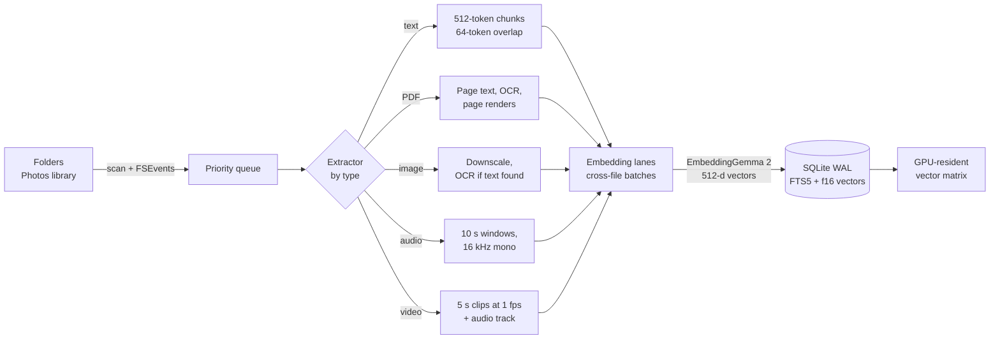
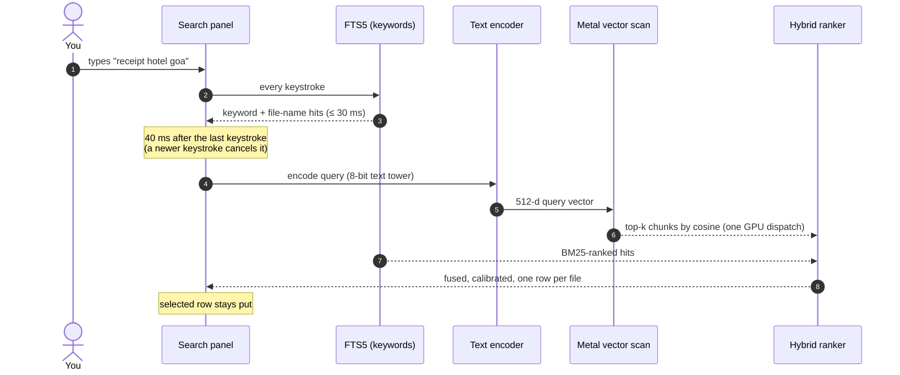
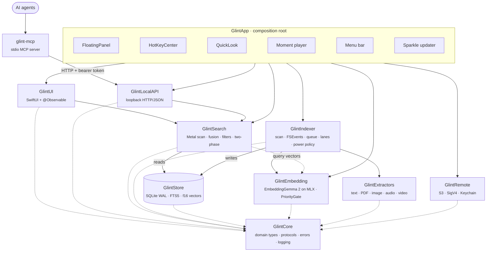

# Architecture

How Glint turns files into a searchable index, how a query becomes a ranked list, and why it is built this way. For the short version, see the [README](../README.md).

## How it works

Glint has two paths that run side by side: **indexing** turns files into vectors and text, and **search** turns a query into a ranked list. They meet only at the store and at a priority gate that always favours search.

### 1. Indexing: from file to vectors



1. **Discover.** The scanner walks each source folder; an FSEvents watcher picks up changes afterwards. Files are content-hashed, so duplicates are embedded once and renames are just metadata updates.
2. **Queue.** Documents and images go first, then audio, then video, so the most searchable items are ready soonest.
3. **Extract.** One extractor per media type streams *chunks*: a passage of text, a PDF page, an image, a 10-second audio window, a 5-second video clip. Text found by OCR or an optional on-device transcript goes into the keyword index.
4. **Embed.** Chunks from many files are packed into shared model calls (*embedding lanes*). A long video streams through in windows and never holds every frame in memory.
5. **Commit.** Each file is written in one transaction, so it is either fully indexed or still pending. Files that finish during a commit join the next one (*group commit*).

### 2. Search: from keystroke to result



1. **Keyword phase.** FTS5 matches chunk text and file names on every keystroke. File names are searchable seconds after the first scan, before any embedding has run.
2. **Semantic phase.** The query is embedded by the small, always-warm text tower and compared against every stored vector in a single Metal dispatch.
3. **Calibration.** Raw cosine scores mean different things in different libraries. Glint drops semantic hits that don't stand out from the query's score distribution over *your* library (z-score and robust z-score cut-offs), while keeping hits with a high absolute similarity. This is what lets a search for something you don't have return nothing instead of ten random photos.
4. **Fusion.** Keyword and semantic lists are fused by normalized score, collapsed to the best chunk per file, and given a small recency boost. Partial keyword matches survive only when the file's meaning is also related to the query.

### 3. Why it stays instant

| Technique | Effect |
| --- | --- |
| Vectors in one `Float16` matrix in a shared-storage `MTLBuffer` | CPU writes rows, GPU reads them, no copies; a 100k × 512 scan takes 2.3 ms |
| Only the text tower stays resident, quantized to 8 bit | Query embedding in ~7 ms; vision and audio towers load for indexing and unload when idle |
| Separate read-only WAL connection for search | The search path never waits on the indexer's writes |
| BM25 ranks at most the newest 5,000 FTS matches | A two-letter prefix on a large library stays under budget |
| `PriorityGate` | Indexing waits for search and shrinks its batches while you type |

### 4. People: faces grouped by person

Photos and videos also go through face recognition while they are indexed, so the **People** view fills in as indexing runs.

1. **Find.** Apple's Vision detects faces and their landmarks in each photo, and in the keyframe of every 5-second video clip. Faces under 40 px or with very low capture quality are skipped, and a face already seen in the same video is not counted again.
2. **Identify.** Each face is aligned to a standard 112 × 112 pose from its eyes, nose and mouth corners, then [SFace](https://github.com/opencv/opencv_zoo/tree/main/models/face_recognition_sface), a small face-recognition model bundled with the app, turns it into a 128-number fingerprint. This takes about 8 ms per photo.
3. **Group.** Every 30 seconds while indexing, and whenever the queue empties, new faces join the person whose average face they are closest to, or start a new person. People who turn out to be the same are merged, but two people you have named never are.
4. **Show.** A person appears once they are in at least two photos or videos, or once you name them. Opening a video from their page plays it from the moment their face is clearest.

Re-indexing a file keeps its faces' people and names. Libraries indexed before People existed show a **Find People** button that re-indexes their photos and videos.


## Modules and boundaries

### Module graph

Every module depends inward on `GlintCore`. `GlintApp` is the only composition root; services receive dependencies through initialisers, never singletons. `scripts/check_imports.sh` enforces the graph, so a sideways import fails CI.



### Modules

| Module | Responsibility |
| --- | --- |
| **`GlintCore`** | Domain types and the core protocols: `EmbeddingProvider`, `ContentExtractor`, `VectorIndex`, `QueryEncoding`, `IndexingService`. Errors, logging, signposts. |
| **`GlintExtractors`** | One extractor per type. Text: encoding detection, 512/64-token chunks. PDF: per-page text, OCR for scanned pages, page renders. Image: downscale and Vision OCR. Audio: 16 kHz mono windows, waveform, optional transcript and sound labels. Video: 5 s clips at 1 fps plus the audio track. `FaceAnalyzer`: Vision face detection, alignment and the bundled SFace model. |
| **`GlintEmbedding`** | `EmbeddingGemma2Provider` (text, vision and audio towers on MLX-Swift), `EG2Tokenizer`, `ModelStore` (pinned, resumable, verified download), `AppleOnDeviceEmbeddingProvider` (fallback), `PriorityGate`. |
| **`GlintStore`** | ~150-line wrapper over system SQLite. `IndexWriter` (single writer, one transaction per file), `IndexReader` (separate WAL reader), FTS5, migrations, thumbnails, faces and people (`FaceClusters`). |
| **`GlintSearch`** | `FlatVectorIndex` (Metal kernel with an Accelerate fallback), `HybridRanker` (score fusion, calibration, best chunk per file, recency), two-phase `SearchEngine`, query tokens, snippets, retrieval metrics. |
| **`GlintIndexer`** | Scanner, FSEvents watcher, priority queue, worker pool, embedding lanes, group commit, power and thermal policy, content-hash dedupe, move/rename detection, Photos library. |
| **`GlintUI`** | Search panel, main window (sidebar, grid/list, inspector, People), PDF viewer, Settings, onboarding, menu bar content, view models. |
| **`GlintLocalAPI`** | Loopback JSON API with bearer-token auth, for scripts and agents. |
| **`GlintRemote`** | `RemoteStorage` for S3-compatible buckets (SigV4 on CryptoKit, ListObjectsV2, GetObject); secret keys in the Keychain. The indexer sees only the `RemoteStorage` protocol from GlintCore. |
| **`GlintMCP`** · `glint-mcp` | Self-contained MCP server over stdio that talks HTTP to the running app. |
| **`GlintEval`** · `glint-eval` | Retrieval eval and indexing benchmark harness using the real extractors and model. |

### Extension points

Adding a capability means adding one conformance:

```swift
/// Adding a model means adding one conformance.
public protocol EmbeddingProvider: Sendable {
    var descriptor: ModelDescriptor { get }
    func embed(_ batch: [EmbeddingInput], purpose: EmbeddingPurpose) async throws -> [Embedding]
}

/// Adding a file type means adding one conformance.
public protocol ContentExtractor: Sendable {
    static var contentTypes: Set<UTType> { get }
    func chunks(of file: FileRef) -> AsyncThrowingStream<Chunk, any Error>
}
```

Every vector is tagged with its model's *space* (id, version, dimension). When the active model changes, the indexer re-queues files from any other space, so vectors from different models never mix.

### On-disk layout

Everything Glint derives lives in one directory. **Settings › Delete Index** removes it entirely.

```text
~/Library/Application Support/Glint/
├── index.sqlite        # files, chunks, FTS5 tables, f16 vector blobs, faces and people (WAL)
├── Thumbnails/         # previews, keyframes, page renders and face crops
├── Models/             # EmbeddingGemma 2 checkpoint, checksum-verified
├── Diagnostics/
├── api.json            # port + token while the local API runs (mode 0600)
└── api-token           # persistent bearer token (mode 0600)
```


## The model: EmbeddingGemma 2

Glint's default model is **[EmbeddingGemma 2](https://huggingface.co/mlx-community/embeddinggemma-2-bf16)** from Google, released 6 October 2026 under the **Apache-2.0** license. It maps text, images, video and audio into one shared embedding space, which is what makes "one search box for every file" possible.

| Property | Value in Glint |
| --- | --- |
| Checkpoint | `mlx-community/embeddinggemma-2-bf16`, 1.49 GB, pinned to a fixed revision |
| Runtime | Native Swift port on [MLX-Swift](https://github.com/ml-explore/mlx-swift) 0.32 |
| Output dimension | 512 (Matryoshka-truncated from 768 and re-normalized); 768 and 256 available as presets |
| Towers | Text (resident, 8-bit), vision and audio (loaded on demand, unloaded when idle) |
| Tokenizer | `EG2Tokenizer`, a compact BPE over `tokenizer.json` (~150 MB lighter than swift-transformers) |
| Parity with the Python reference | Identical token ids; cosine ≥ 0.9998 for text, images, documents and audio |
| Query latency | p50 6.8 ms / p95 8.0 ms (M5, Release) |
| Download | Once, resumable, every file SHA-256-verified before use |

<details>
<summary><b>Parity gate details</b></summary>

The port is checked against the Python reference in `Tests/GlintEmbeddingTests/EmbeddingGemma2ParityTests.swift` (fixtures from `scripts/model/make_parity_fixtures.py`). M5, Release:

| Check | Result |
| --- | --- |
| Token ids, 5 texts incl. CJK, emoji, code | identical |
| Text embeddings | cosine 0.99997–1.0 |
| Image preprocessing (resize, patches, positions) | identical pixels (Pillow's bicubic resampler is reimplemented bit-exactly) |
| Photo / document / photo + text, end to end | 0.99998 / 0.99981 / 0.99997 |
| Audio (features + conformer) | 0.99995 |

The tokenizer is additionally checked against Hugging Face's Rust tokenizer on 42 hard cases and a 30k-text corpus with zero mismatches.

</details>

**Fallback model.** Until the download finishes, or if the model fails to load, Glint uses `AppleOnDeviceEmbeddingProvider`: Vision scene labels and SoundAnalysis sound labels plus OCR text, embedded with `NLEmbedding`. It needs no download and ships with macOS, but it is English-only and noticeably weaker on visual content.


## Technical decisions

Every significant decision is recorded as an Architecture Decision Record in [`docs/adr`](adr). The short version:

| # | Decision | Why |
| :-: | --- | --- |
| [0001](adr/0001-swiftpm-and-direct-distribution.md) | **One Swift package, direct distribution, not sandboxed** | The App Sandbox conflicts with indexing arbitrary folders and external drives. One `Package.swift` declares every module; CI and local builds use the same commands. |
| [0002](adr/0002-interim-embedding-provider.md) | **Apple frameworks as a fallback provider** | Everything above the `EmbeddingProvider` protocol could be built and tested before the model port existed, and search works before the download finishes. |
| [0003](adr/0003-system-sqlite.md) | **System SQLite instead of GRDB** | FTS5 ships with macOS. A ~150-line wrapper keeps the shipping app free of database dependencies, with owned, tested migrations. |
| [0004](adr/0004-search-path-performance.md) | **Flat GPU-resident `Float16` matrix, not an ANN index** | At 100k × 512 an exact scan is 2.3 ms and ~100 MB. Exact search means no recall loss and no index to rebuild; a quantized coarse scan is deferred until libraries outgrow memory. |
| [0006](adr/0006-mlx-and-embeddinggemma-2.md) | **EmbeddingGemma 2 on MLX-Swift** | One open, commercially usable model for all media, running natively on Apple silicon, with a parity gate against the reference. |
| [0007](adr/0007-sparkle-updates.md) | **Sparkle 2 for updates** | The de facto standard for signed, delta, out-of-sandbox updates in direct-download Mac apps. |
| [0008](adr/0008-indexing-pipeline.md) | **Streaming pipeline in Swift with automatic OCR** | Indexing time is spent in Apple frameworks and the model, not Glint's code, so Rust would add FFI without speed. Streaming, cross-file batching and selective OCR gave up to 10× throughput. |
| [0009](adr/0009-network-shares.md) | **Network shares as folder sources, kept current by polling** | FSEvents misses changes made on other machines, so shares are rescanned on a timer and on mount or wake. An unreachable source keeps its files; nothing is deleted until the source can be read again. |
| [0010](adr/0010-remote-sources.md) | **S3 buckets downloaded to index, never mounted** | Objects are listed over the S3 API, downloaded one at a time, indexed and deleted. Secret keys stay in the Keychain; an unreachable bucket or rejected key keeps its index. |

A few decisions that are visible in the code rather than an ADR:

- **Score fusion over reciprocal rank fusion.** Fusing normalized scores beat RRF on every eval (SciFact MRR 0.798 → 0.811; literal look-ups such as gene names, Recall@10 0.925 → 0.975), because a near-exact match and a marginal one no longer count the same just for sitting at the same rank.
- **Per-library calibration instead of a fixed threshold.** Cut-offs are z-scores over the query's score distribution in *your* library, tuned with `glint-eval` across five benchmarks. Every constant in `ModelCatalog.swift` and `HybridRanker.swift` carries a comment with the measurement that set it.
- **Fast OCR at 2048 px.** It matched accurate recognition on 99.96% of screenshot words at 27 ms instead of 149–421 ms. Camera photos run a 1–3 ms text check first and skip OCR when there is no text.
- **A dedicated face model, not Vision feature prints.** Vision's general-purpose image prints told faces apart poorly on LFW: keeping wrong matches to 0.5% grouped only about 30% of same-person pairs. SFace (MobileFaceNet, Apache-2.0, 18 MB as Core ML) separates them cleanly, so it is bundled; `scripts/model/convert_sface.py` converts it and checks the output against onnxruntime.
- **People grouping errs towards splitting.** The join threshold (0.55 cosine) was picked with `glint-eval faces` where precision stays at 99%. A person split in two is fixed by naming both groups the same; two people merged into one are much harder to untangle.
- **Hashing and Vision on GCD, never the cooperative pool.** Synchronous Vision calls on Swift's cooperative thread pool can deadlock.

